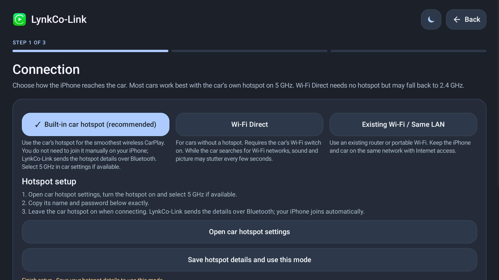
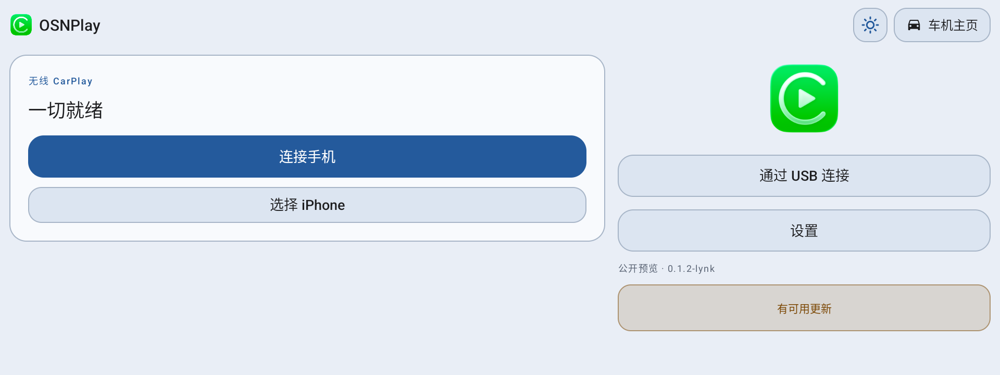
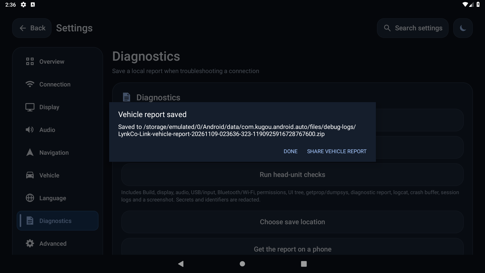
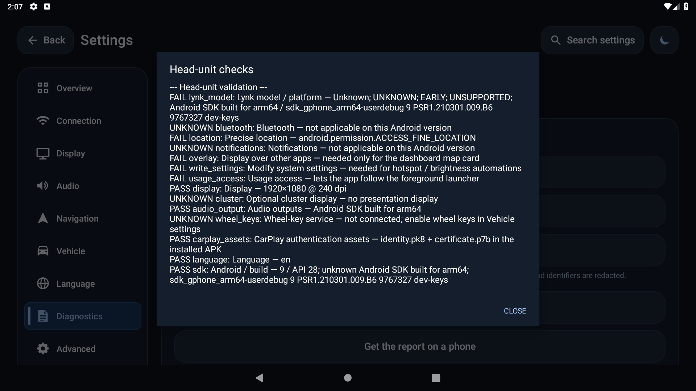

# LynkCo-Link

**[English](README.md) | [简体中文](README.zh-CN.md)**

**CarPlay for Lynk & Co OSN head units.**

[](https://github.com/Jas0n0ss/LynkCo-Link/actions/workflows/android.yml)
[](https://github.com/Jas0n0ss/LynkCo-Link/releases)

LynkCo-Link runs on the **head unit**. It needs no jailbreak, dongle or authentication server. The public APK includes authentication assets and can connect directly.

## Supported cars

| Car | Generation | Status |
| --- | --- | --- |
| Lynk & Co 01 / 02 / 03 / 05 / 06 | Late, Snapdragon 8155 / OSN 2.0 | Primary target |
| Lynk & Co 01 / 02 / 03 / 05 / 06 | Early, 820A / early OSN | Compatibility range, per-car validation |
| Other cars | — | Unsupported |

Only the Lynk models above are targeted; 8155 / OSN 2.0 comes first.

See [compatibility](docs/COMPATIBILITY.md).

The UI ships in **English by default** and includes Simplified/Traditional Chinese, Arabic, Russian, Spanish, Ukrainian, Japanese, Korean, Italian and Turkish. Change it in Settings → Language.

## Screenshots

| Connection | 1920×720 |
| --- | --- |
|  |  |

Collect a redacted vehicle report from Settings → Diagnostics:



Run head-unit checks before a real-car session:



## Download and install

The current single APK covers Lynk & Co 01/02/03/05/06 and uses the model token `general`,
for example `LynkCo-Link-0.3.6-general-signed.apk`; a model-specific build uses `01`, `03`, etc.

From [Releases](https://github.com/Jas0n0ss/LynkCo-Link/releases/latest), or:

```sh
gh release download --repo Jas0n0ss/LynkCo-Link
```

> The package name is `com.kugou.android.auto`, used only to pass the OSN Launcher3 whitelist. The app is LynkCo-Link and contains no Kugou features. Remove any real Kugou head-unit app before installing.

### Install

**USB drive**: copy the APK to a FAT32 drive, open it from the head-unit file manager, allow unknown sources and install.

**ADB**:

1. Open native Android settings (common entry: dial `2468789`).
2. About device → tap Build number 7 times → Developer options → enable USB debugging.
3. Connect to a computer:

```sh
adb devices
adb install -r LynkCo-Link-<version>-<car-model>-signed.apk
```

Launch once after installing; Android stopped state keeps boot start disabled until then:

```sh
adb shell am start -n com.kugou.android.auto/com.shilapi.xcertplay.LynkCoLinkActivity
```

The first run goes straight to “Connection → Choose iPhone”; it does not ask for a DiLink version.

### No icon in the app list

LynkCo-Link uses a whitelisted Launcher3 package name, so it should appear. If it does not:

1. Reboot the head unit and check “All apps”.
2. Confirm the package is installed: `adb shell pm list packages | grep com.kugou`.
3. Or start it with ADB:

```sh
adb shell am start -n com.kugou.android.auto/com.shilapi.xcertplay.LynkCoLinkActivity
```

### Connect iPhone

- **Wired**: connect to the USB-A data port, open LynkCo-Link, tap Allow on the iPhone.
- **Wireless**: LynkCo-Link → Connection, choose car hotspot / Wi-Fi Direct / Existing Wi-Fi and pair.
- On failure: Settings → Diagnostics → Save diagnostic report.

## Update and uninstall

Each update is a separate Release; all historical releases are kept. From the old `com.lynkco.link.lynk` package, uninstall before installing.

```sh
adb uninstall com.kugou.android.auto
```

Uninstalling removes settings and pairing records.

## Build from source

Requires JDK 17+, Android SDK Platform 37.2, Build-Tools 37.0.0 and NDK 28.2.13676358. Authentication assets and the release keystore are never committed.

See [build instructions](docs/BUILD.md).

## TODO

Detailed owner-by-owner steps: [docs/NEXT-STEPS.md](docs/NEXT-STEPS.md).


- [ ] Real-car acceptance on Lynk 01/03 (8155 / OSN 2.0): wired and wireless.
- [ ] Validate audio, microphone, Siri, calls and steering-wheel keys.
- [ ] Test permission denial, ignition/reboot, background and OTA upgrade.
- [ ] Verify Lynk 02/05/06 and early 820A compatibility.
- [ ] Implement the real Lynk vehicle SDK (HVAC/media) and optional cluster projection.
- [ ] Complete translations for the new debug-log strings.
- [ ] Validate update checks and the CI release pipeline after the repository rename.

## Docs

- [Install](docs/INSTALL.md) · [Build](docs/BUILD.md) · [Compatibility](docs/COMPATIBILITY.md)
- [Testing](docs/TESTING.md) · [Real-car acceptance](docs/LYNK-ACCEPTANCE.md)
- [Next steps / user TODO](docs/NEXT-STEPS.md) · [UI design review](docs/DESIGN-REVIEW-APPLE.md) · [Privacy](docs/PRIVACY.md) · [Security](SECURITY.md)
- [License](LICENSING.md) · [Third-party notices](docs/THIRD_PARTY_NOTICES.md)

## Sources and credits

LynkCo-Link is based on these public projects:

| Project | Role |
| --- | --- |
| [DiPlay](https://github.com/shihabal3amri/DiPlay) | Main baseline (0.2.22): CarPlay transport, audio, video and settings |
| [LynkCo-DiPlay](https://github.com/soBigRice/LynkCo-DiPlay) | Lynk & Co OSN environment checks, diagnostics and head-unit work |
| [xcertplay](https://github.com/shilapi/xcertplay) | Receiver base and project structure behind DiPlay |
| [diplay-ecarx](https://github.com/jianyun8023/diplay-ecarx) | Lynk & Co 01 / ECARX platform permissions and real-car notes |

See [LICENSING.md](LICENSING.md) and [third-party notices](docs/THIRD_PARTY_NOTICES.md) for licenses and copyright.

## Disclaimer

- Not an Apple-certified product; not affiliated with or endorsed by Apple Inc. or Lynk & Co. CarPlay and its icon belong to Apple Inc.
- The APK contains an extractable experimental identity; future iOS updates may break it, and public distribution is at your own risk.
- Installing third-party APKs may affect the warranty; do it while parked.

## License

Based on DiPlay / xcertplay (GPL-3.0); some settings UI files are AGPL-3.0-only. See [LICENSING.md](LICENSING.md).

[简体中文](README.zh-CN.md)
