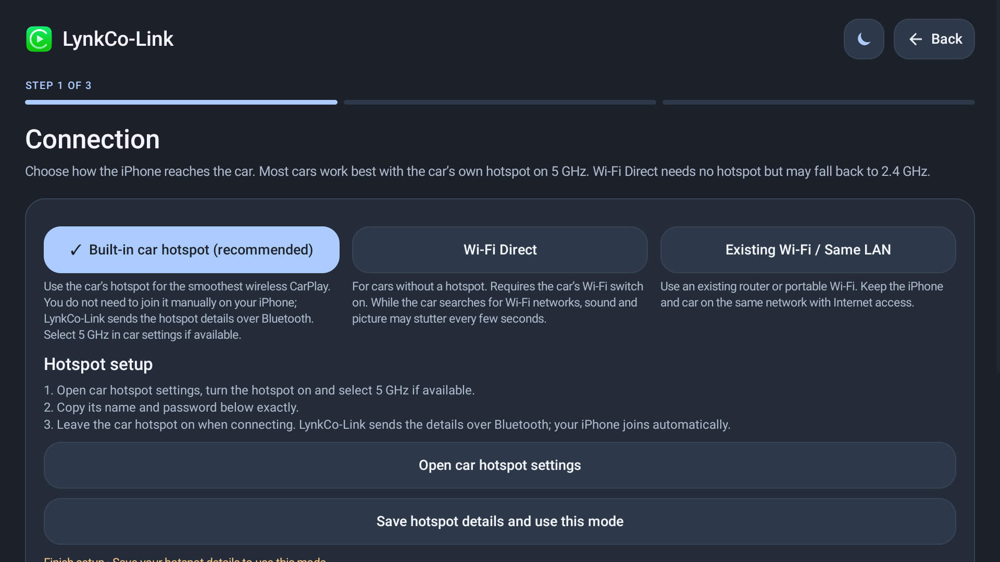
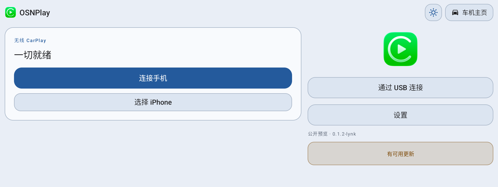
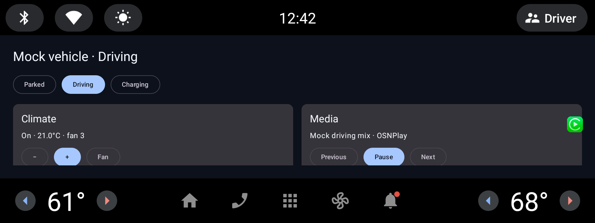

# LynkCo-Link

**[English](README.md) | [简体中文](README.zh-CN.md)**

**在领克（Lynk & Co）OSN 车机上使用 CarPlay。**

[](https://github.com/Jas0n0ss/LynkCo-Link/actions/workflows/android.yml)
[](https://github.com/Jas0n0ss/LynkCo-Link/releases)
[](LICENSING.md)

LynkCo-Link 安装在**车机**上，不需要越狱 iPhone、外设或认证服务器。公开 Release 的 APK 已内置认证资产，安装后可直接连接。

## 适配车型

| 车型 | 时期 | 状态 |
| --- | --- | --- |
| 领克 01 / 02 / 03 / 05 / 06 | 晚期，骁龙 8155 / OSN 2.0 | 首要适配目标 |
| 领克 01 / 02 / 03 / 05 / 06 | 早期，820A / 早期 OSN | 兼容范围，待逐车确认 |
| 其他车型 | — | 不支持 |

只适配上述领克车型；8155 / OSN 2.0 优先。

详见 [兼容性说明](docs/COMPATIBILITY.md)。

界面**默认英文**，同时内置简体/繁体中文、阿拉伯语、俄语、西班牙语、乌克兰语、日语、韩语、意大利语和土耳其语，可在“设置 → 语言”切换。

## 界面截图

| 连接页 | 1920×720 |
| --- | --- |
|  |  |



## 下载与安装

只下载一个文件：

```text
LynkCo-Link-<version>-<car-model>-signed.apk
```

当前单包覆盖领克 01/02/03/05/06，通用包车型标识使用 `general`，例如
`LynkCo-Link-0.3.6-general-signed.apk`；单车型包使用 `01`、`03` 等。

从 [Releases](https://github.com/Jas0n0ss/LynkCo-Link/releases/latest) 下载，或：

```sh
gh release download --repo Jas0n0ss/LynkCo-Link
```

> 包名是 `com.kugou.android.auto`，只用于通过 OSN 桌面白名单。应用本身是 LynkCo-Link，不含酷狗功能。安装前确认车机没有真正的酷狗车机版。

### 准备

- 车停稳，准备好 iPhone。
- 一根支持数据传输的 USB 线，或 FAT32 U 盘。
- 可选：电脑安装 [Android Platform-Tools](https://developer.android.com/tools/releases/platform-tools)。

### 安装

**U 盘**：把 APK 拷到 U 盘，插车机 USB 口，用文件管理器打开安装。

**ADB**：

1. 车机进入原生 Android 设置（常见入口：拨号输入 `2468789`）。
2. 关于设备 → 连续点击版本号 7 次 → 开发者选项 → 打开 USB 调试。
3. 连接电脑，执行：

```sh
adb devices
adb install -r LynkCo-Link-<version>-<car-model>-signed.apk
```

安装后首次必须手动打开一次，否则 Android stopped state 会让开机自启失效：

```sh
adb shell am start -n com.kugou.android.auto/com.shilapi.xcertplay.LynkCoLinkActivity
```

首次打开会直接进入“连接 → 选择 iPhone”，不会询问 DiLink 版本。

### 桌面没有图标

LynkCo-Link 已使用原厂 Launcher3 白名单包名，正常会出现在应用列表。如果仍没有：

1. 重启车机，再找“所有应用 / 应用管理”。
2. 确认包已安装：`adb shell pm list packages | grep com.kugou`。
3. 或用 ADB 启动：

```sh
adb shell am start -n com.kugou.android.auto/com.shilapi.xcertplay.LynkCoLinkActivity
```

### 连接 iPhone

- **有线**：数据线接车机 USB-A 数据口，打开 LynkCo-Link，iPhone 点“允许”。
- **无线**：LynkCo-Link → 连接设置，选择车机热点 / Wi-Fi Direct / Existing Wi-Fi，按提示配对。
- 失败时：设置 → 诊断 → 保存诊断报告。

## 常见问题

| 问题 | 处理 |
| --- | --- |
| `adb: command not found` | 安装 Platform-Tools，或在 Platform-Tools 目录执行 |
| `device unauthorized` | 车机上允许 USB 调试；仍失败就撤销授权后重连 |
| `INSTALL_FAILED_USER_RESTRICTED` | 开发者选项打开“USB 安装/未知来源” |
| `INSTALL_FAILED_UPDATE_INCOMPATIBLE` | 先卸载旧的 `com.lynkco.link.lynk` 或旧入口包，再安装（会丢设置） |
| 装完桌面找不到 | 重启车机；检查包列表；或 ADB 启动 |
| 无法连接 CarPlay | 确认 iPhone 已解锁、蓝牙/Wi-Fi 已开，并导出诊断报告 |
| 有真正的酷狗车机版 | 两者包名冲突，先卸载酷狗车机版 |

## 更新与卸载

新版本会作为独立 Release 发布，所有历史版本都会保留。覆盖安装前确认包名和签名一致；从旧的 `com.lynkco.link.lynk` 升级需要先卸载。

```sh
adb uninstall com.kugou.android.auto
```

卸载会清除设置和配对记录。

## 从源码构建

需要 JDK 17+、Android SDK Platform 37.2、Build-Tools 37.0.0、NDK 28.2.13676358。认证资产和 release keystore 不进入仓库。

完整步骤见 [构建说明](docs/BUILD.md)。

## 待办

用户与开发的分工和逐步操作见 [docs/NEXT-STEPS.md](docs/NEXT-STEPS.md)。


- [ ] 领克 01/03（8155 / OSN 2.0）实车验收：有线与无线。
- [ ] 验证音频、麦克风、Siri、通话和方向盘按键。
- [ ] 测试权限拒绝、熄火重启、后台和 OTA 升级。
- [ ] 验证领克 02/05/06 与早期 820A 兼容性。
- [ ] 实现真实领克车辆 SDK（空调/媒体）和可选仪表投射。
- [ ] 补齐调试日志新增字符串的多语言翻译。
- [ ] 验证仓库改名后的更新检查和 CI 发布流程。

## 文档

- [安装](docs/INSTALL.md) · [构建](docs/BUILD.md) · [兼容性](docs/COMPATIBILITY.md)
- [测试](docs/TESTING.md) · [隐私](docs/PRIVACY.md)
- [下一步 TODO（用户/开发分工）](docs/NEXT-STEPS.md) · [安全](SECURITY.md)
- [许可](LICENSING.md) · [第三方声明](docs/THIRD_PARTY_NOTICES.md)

## 来源与致谢

LynkCo-Link 的代码和领克适配来自以下公开项目：

| 项目 | 作用 |
| --- | --- |
| [DiPlay](https://github.com/shihabal3amri/DiPlay) | 主基线（0.2.22），CarPlay 传输、音频、视频和设置体系 |
| [LynkCo-DiPlay](https://github.com/soBigRice/LynkCo-DiPlay) | 领克 OSN 的环境检测、连接诊断和车机适配经验 |
| [xcertplay](https://github.com/shilapi/xcertplay) | DiPlay 的接收端底座和工程结构 |
| [diplay-ecarx](https://github.com/jianyun8023/diplay-ecarx) | 领克 01 / ECARX 平台权限和实车经验参考 |

各项目的许可证和版权声明见 [LICENSING.md](LICENSING.md) 与 [第三方声明](docs/THIRD_PARTY_NOTICES.md)。

## 声明

- 非 Apple 认证产品，与 Apple Inc.、领克汽车无隶属或背书关系；CarPlay 图标归 Apple Inc.。
- APK 含可提取的实验性认证身份，未来 iOS 更新可能失效，公开分发风险自担。
- 在车机安装第三方 APK 可能影响质保；请在驻车状态操作。

## 许可

基于 DiPlay / xcertplay（GPL-3.0）二次开发，部分设置 UI 为 AGPL-3.0-only，整体为 GPL/AGPL 组合作品。详见 [LICENSING.md](LICENSING.md)。

[English](README.md)
