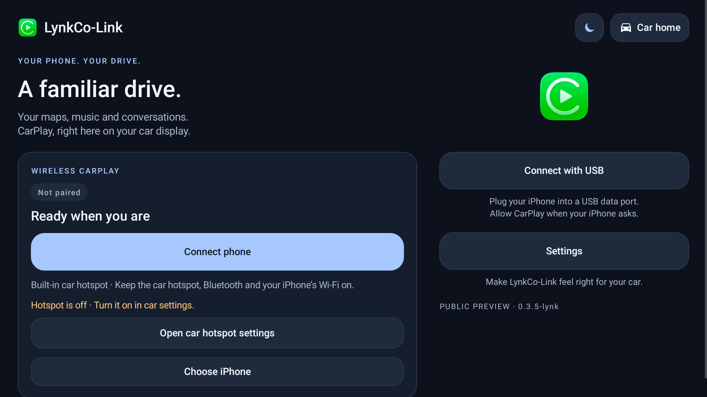
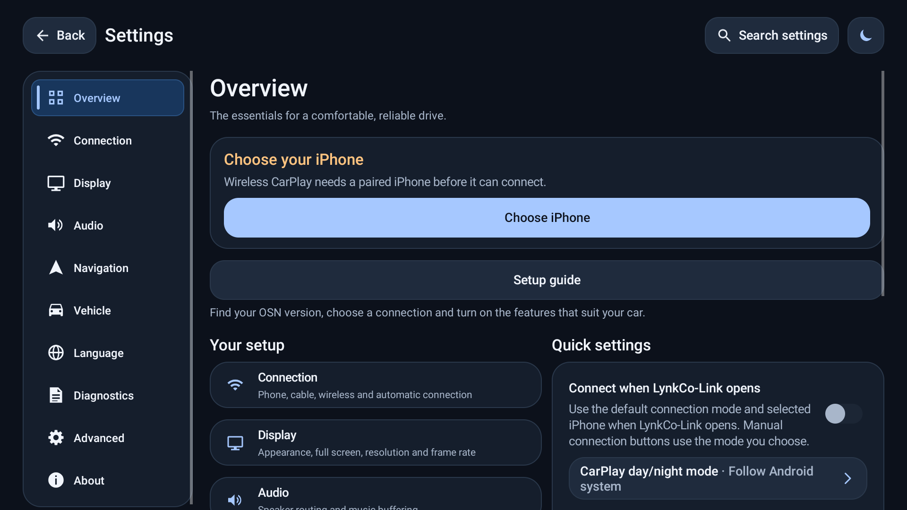

# UI 设计审查：Apple HIG / Liquid Glass 视角

审查对象：LynkCo-Link 0.3.5，Android 9 / OSN 车机，1920×1080 与 1920×720，横屏。
平台说明：这是 Android 车机，不是 iOS。Apple 的平台组件不能直接套用；这里采用 HIG 的原则、排版、可访问性和材料纪律，并翻译到现有 View 体系。

## 结论

**评级：Good（修复后）。**

整体是“安静的驾驶舱”：深蓝黑底色、一个浅蓝强调色、绿色只属于 CarPlay 品牌图标、卡片和按钮同一套圆角语言。主要问题不在视觉风格，而在**车机可读性、文案残留和主次层级**。

本轮已修：

- 设置页残留的 **DiLink** 文案，改为 OSN。
- 正文 15sp → 17sp，说明 14sp → 16sp，最小标签 12sp → 14sp。
- 首页状态胶囊从悬空的 “Ready for” 改为 “Not paired” 或 “Ready for <iPhone>”。
- 首页次要按钮高度 56dp → 52dp，保留主按钮 68dp。
- 移除首页底部无信息量的 “PUBLIC PREVIEW · version”。

## 高优先级

### 1. 车机字号偏小（已修）

原设置页正文 15sp、说明 14sp、眉标 12sp。车机观看距离比手机远，HIG 的移动端默认正文是 17pt，最小 11pt；控件最小 44×44pt。

- 依据：`accessibility.md › Vision`、`accessibility.md › Mobility`
- 修复：正文 17sp，说明 16sp，最小标签 14sp；按钮保持 18sp。
- 验证：1080p 与 720p 下可滚动、无截断；大字体 1.3× 仍可用。

### 2. 旧品牌文案破坏信任（已修）

设置页曾显示 “Find your DiLink version…”。这是 BYD/DiLink 清理后的内容残留。对车机用户来说，这比任何视觉问题都严重。

- 依据：`color.md › Best practices`（语义一致）与文案原则：界面里的每个词都要说真话。
- 修复：改为 “Find your OSN version…”、 “OSN version”。
- 同时全局清理了 strings 里的 DiLink 字样。

### 3. 状态胶囊语义不完整（已修）

首页在未选择 iPhone 时显示 “Ready for”，句子没有宾语。

- 修复：未配对显示 **Not paired**；已配对显示 **Ready for <iPhone 名称>**。
- 颜色仍只表达状态：灰色=未配对，绿色=已连接，蓝色=连接中，橙色=需处理。

### 4. 首页次要动作与主按钮竞争（部分修复）

首页卡片内同时有 3 个接近全宽的按钮：Connect phone（主）、Open car hotspot settings、Choose iPhone。HIG 建议一屏最多 1–2 个突出按钮，其他动作降低视觉重量。

- 依据：`buttons.md › Style`
- 已做：次要按钮 56dp → 52dp；主按钮保持 68dp。
- 未做：把两个次要动作合并成一行。1920 宽足够，但会牵动现有焦点顺序和测试，建议下一轮专门做。

## 中优先级

### 5. 设置项数量偏多

左侧有 10 个分类。HIG 建议尽量减少设置数量，但车机连接、显示、音频、方向盘确实需要分组；当前用左侧栏分组是可接受的。

- 依据：`settings.md › Best practices`
- 建议：把 Advanced 下的实验功能继续折叠到二级页，不增加一级分类。

### 6. 设置内容在 1920 宽下行长偏长

概览右侧卡片和说明在 1920 宽下超过 75 字符的舒适阅读长度。下一步可把主内容限制在约 1100–1200dp，左右留白，而不是继续拉宽卡片。

- 依据：`layout.md › Visual hierarchy`、`layout.md › Adaptability`
- 本轮未改：会影响双栏和现有布局测试。

### 7. 外观切换与系统设置

应用内提供日/夜切换，而 HIG 不建议应用自己再做一套外观开关。车机场景下这是合理例外：车机光照、CarPlay 日/夜模式与 Android 系统模式可能不同步。保留，但应在文案里说明它是“应用外观”，不是系统外观。

- 依据：`dark-mode.md › Best practices`
- 判断：这是产品取舍，不当作缺陷。

## Liquid Glass 结论

**没有把卡片做成毛玻璃，是正确决定。**

真正的 Liquid Glass 需要背景采样、折射、边缘高光、亮度压缩和动态合并；OSN 当前是 Android 9（API 28），没有 `RenderEffect` 一类的运行时模糊能力。用半透明卡片加白色描边只会得到 2020 年的 glassmorphism，而不是 Apple 的材料。

- 依据：`materials.md › Liquid Glass`：Liquid Glass 是功能层材料，不应进入内容层。
- 依据：`liquid-glass/design-rules.md › 4. Where glass belongs` 与 `› 8. Anti-patterns`：不要玻璃叠玻璃、不要给每张卡片加玻璃、不要把透明当装饰。
- 当前做法：卡片保持实色 tonal surface；强调色只用于主操作和状态；圆角、1px 边、焦点环统一。
- 如果未来目标升到 Android 12+，可以只给**顶部命令栏/浮动操作层**加 regular glass，并保留 Reduce Transparency 的实色回退；内容卡片仍然不透明。

## 做得好的地方

- 深色对比度：正文/背景 17.28:1，次要文字/卡片 8.14:1，强调色/背景 11.09:1；浅色模式次要文字 5.14:1。都高于 4.5:1。
- 触控目标 52–68dp，高于 44dp 最低要求；D-pad 焦点环可见。
- 一个强调色、一个品牌绿；没有“每个按钮都染色”。
- 左侧栏 + 内容区在 1920 横屏下比底部标签栏更适合车机。
- 卡片分组用空间和 1px 边，不靠大量分割线，符合 `layout.md › Visual hierarchy`。

## 本轮截图

首页：

设置：

## 下一轮建议

1. 首页两个次要动作合并为一行，减少卡片高度。
2. 设置主内容限制最大宽度，改善 1920 下的行宽。
3. 设置页大字体 1.3× 的完整截图回归（当前已人工验证，尚无自动截图）。
4. 若目标 API 升到 31+，再评估顶部命令栏的 regular glass，而不是内容卡片。
