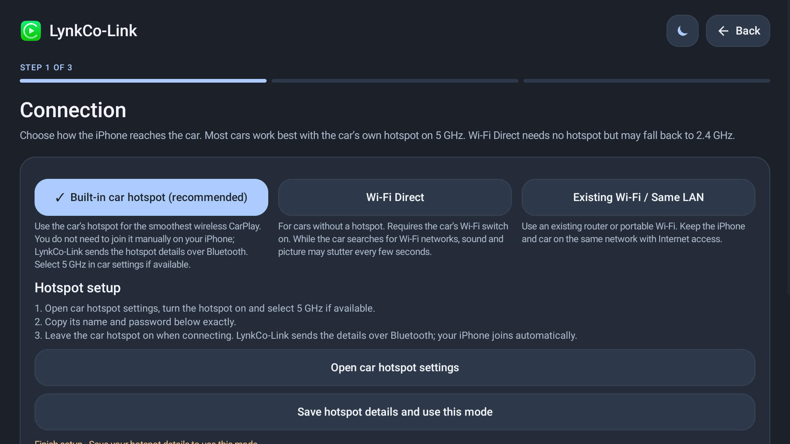
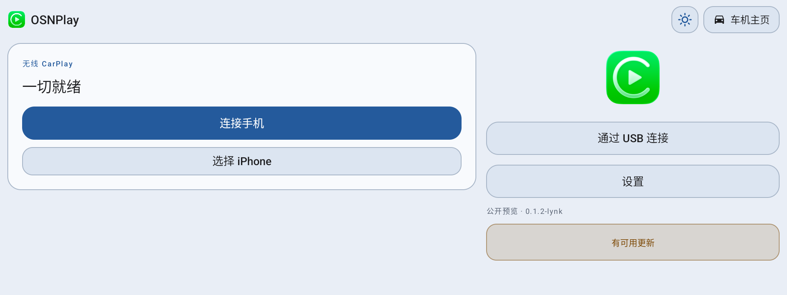
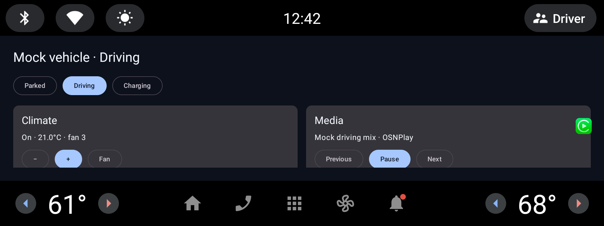

# 领克 OSN 本地仿真测试指南

面向 8155 / LYNK OS N（Android 9 / API 28）的本地 AVD、横屏 UI、车机输入和 Mock SDK 测试。

## 1. 环境基线

| 项目 | 推荐值 |
| --- | --- |
| Android Studio | 最新稳定版 |
| JDK | 17+ |
| System Image | `system-images;android-28;google_apis;arm64-v8a`（Apple Silicon） |
| 设备 | `automotive_1080p_landscape` 或自定义 1920×1080 横屏 |
| 分辨率 | 1920×1080（主）/ 1920×720（超宽回归） |
| 密度 | 240 dpi |
| RAM / 堆 | 4096 MB / 512 MB |
| GPU | `swiftshader_indirect`（无窗口/CI）或硬件加速 |
| 键盘 / D-pad | 开启 |

> OSN 实际版本存在差异；仿真只能验证布局、焦点、生命周期和 Mock 逻辑，不能替代实车。

## 2. 创建 API 28 AVD

```sh
sdkmanager "platform-tools" "emulator" \
  "system-images;android-28;google_apis;arm64-v8a"

avdmanager create avd -n lynk_api28 \
  -k "system-images;android-28;google_apis;arm64-v8a" --force
```

编辑 `~/.android/avd/lynk_api28.avd/config.ini`：

```ini
hw.lcd.width=1920
hw.lcd.height=1080
hw.lcd.density=240
hw.keyboard=yes
hw.dPad=yes
hw.mainKeys=no
hw.gpu.enabled=yes
hw.gpu.mode=swiftshader_indirect
hw.ramSize=4096
vm.heapSize=512
disk.dataPartition.size=8G
hw.initialOrientation=landscape
```

启动：

```sh
emulator -avd lynk_api28 \
  -no-snapshot -no-audio -no-window \
  -gpu swiftshader_indirect -port 5556
adb -s emulator-5556 wait-for-device
```

如果模拟的是带 Google APIs 的 Automotive 镜像，优先用
`system-images;android-33;android-automotive;arm64-v8a` 或
`automotive_1080p_landscape` 设备定义；OSN 本身是定制 Android，不依赖 AAOS VHAL。

## 3. 分辨率与横屏

```sh
adb -s emulator-5556 shell wm size 1920x1080
adb -s emulator-5556 shell wm density 240
adb -s emulator-5556 shell settings put system accelerometer_rotation 0
adb -s emulator-5556 shell settings put system user_rotation 1
```

超宽回归：

```sh
adb -s emulator-5556 shell wm size 1920x720
```

> 1920×720 / 240 dpi 的可视高度只有 480dp，页面必须可滚动或分栏，不能假设 720dp 高度。
> 测试完成后恢复 1920×1080。

## 4. 横屏 UI 适配

### 原则

- 默认 `landscape`，`resizeableActivity=true`。
- 用 `sw600dp`、`land`、`w1280dp`、`h720dp` 限定符，不写死 px。
- 主内容 `widthIn(max = 1440.dp)`，两侧留白，避免 1920 宽被拉伸。
- 列表用 `LazyVerticalGrid(columns = Adaptive(280.dp))` 或两栏 `Row`。
- 固定高度只用于操作栏；文本容器用 `heightIn(min=...)`。
- 触控目标 ≥ 48dp，按钮高度 54–68dp。
- 沉浸式用 `WindowInsetsControllerCompat`，不要用已废弃的 `SYSTEM_UI_FLAG_*`。

### 沉浸式

```kotlin
WindowCompat.setDecorFitsSystemWindows(window, false)
WindowInsetsControllerCompat(window, window.decorView).apply {
    hide(WindowInsetsCompat.Type.systemBars())
    systemBarsBehavior =
        WindowInsetsControllerCompat.BEHAVIOR_SHOW_TRANSIENT_BARS_BY_SWIPE
}
ViewCompat.setOnApplyWindowInsetsListener(root) { v, insets ->
    val bars = insets.getInsets(WindowInsetsCompat.Type.systemBars())
    v.setPadding(bars.left, bars.top, bars.right, bars.bottom)
    insets
}
```

### Compose 响应式示例

```kotlin
@Composable
fun CarScreen() {
    BoxWithConstraints(Modifier.fillMaxSize()) {
        val wide = maxWidth >= 1000.dp
        if (wide) {
            Row(
                Modifier.fillMaxSize().padding(24.dp),
                horizontalArrangement = Arrangement.spacedBy(24.dp),
            ) {
                ConnectionPane(Modifier.weight(1.4f))
                StatusPane(Modifier.weight(1f))
            }
        } else {
            Column(
                Modifier.fillMaxSize().verticalScroll(rememberScrollState()).padding(20.dp),
                verticalArrangement = Arrangement.spacedBy(16.dp),
            ) {
                ConnectionPane(Modifier.fillMaxWidth())
                StatusPane(Modifier.fillMaxWidth())
            }
        }
    }
}

@Composable
fun ConnectionPane(modifier: Modifier = Modifier) {
    Card(modifier.heightIn(min = 240.dp)) {
        Column(Modifier.padding(24.dp), verticalArrangement = Arrangement.spacedBy(16.dp)) {
            Text("连接 iPhone", style = MaterialTheme.typography.headlineSmall)
            Button(
                onClick = {},
                modifier = Modifier.fillMaxWidth().heightIn(min = 56.dp),
            ) { Text("开始连接") }
        }
    }
}
```

### XML 响应式示例

```xml
<androidx.constraintlayout.widget.ConstraintLayout
    android:layout_width="match_parent"
    android:layout_height="match_parent"
    android:padding="24dp">

    <LinearLayout
        android:id="@+id/leftPane"
        android:layout_width="0dp"
        android:layout_height="0dp"
        android:orientation="vertical"
        app:layout_constraintWidth_percent="0.62"
        app:layout_constraintTop_toTopOf="parent"
        app:layout_constraintBottom_toBottomOf="parent"
        app:layout_constraintStart_toStartOf="parent" />

    <LinearLayout
        android:id="@+id/rightPane"
        android:layout_width="0dp"
        android:layout_height="0dp"
        android:orientation="vertical"
        app:layout_constraintWidth_percent="0.34"
        app:layout_constraintTop_toTopOf="parent"
        app:layout_constraintBottom_toBottomOf="parent"
        app:layout_constraintEnd_toEndOf="parent" />
</androidx.constraintlayout.widget.ConstraintLayout>
```

## 5. 车机输入与焦点

常用按键：

```sh
adb shell input keyevent 19   # DPAD_UP
adb shell input keyevent 20   # DPAD_DOWN
adb shell input keyevent 21   # DPAD_LEFT
adb shell input keyevent 22   # DPAD_RIGHT
adb shell input keyevent 23   # DPAD_CENTER / ENTER
adb shell input keyevent 4    # BACK
adb shell input keyevent 3    # HOME
adb shell input text "hello"  # 输入法/文本框
adb shell input tap 960 540
adb shell input swipe 1500 540 400 540 300
```

AAOS emulator 还可以用：

```sh
adb root
adb shell cmd car_service inject-key -d 0 20
adb shell cmd car_service inject-rotary -d 0 -i 10 -c true
```

Compose 焦点：

```kotlin
val first = remember { FocusRequester() }
LaunchedEffect(Unit) { first.requestFocus() }

Button(
    onClick = {},
    modifier = Modifier
        .focusRequester(first)
        .onKeyEvent { event ->
            if (event.type == KeyEventType.KeyDown &&
                event.key == Key.Enter) { /* action */ true } else false
        },
)
```

XML 焦点：

```xml
<Button
    android:nextFocusDown="@id/connectButton"
    android:nextFocusRight="@id/settingsButton"
    android:focusable="true"
    android:focusableInTouchMode="true" />
```

检查清单：

- 只用 D-pad 从首页走到设置、连接、返回。
- 焦点环始终可见；不能只靠 hover/触摸。
- 弹窗打开后焦点进入弹窗，关闭后回到触发按钮。
- 行车中禁止长文本输入、视频和复杂交互。

## 6. Mock SDK 架构

目标：真实车机接口和本地 Mock 共用一套业务代码，Debug 下可切换。

```text
ui
 └─ VehicleViewModel
      └─ VehicleRepository
           └─ VehicleSdk (interface)
                ├─ RealVehicleSdk   → CarPropertyManager / 厂商 Binder
                └─ MockVehicleSdk   → StateFlow 假数据
```

```kotlin
data class VehicleState(
    val speedKmh: Int = 0,
    val gear: Gear = Gear.P,
    val hvac: HvacState = HvacState(),
    val media: MediaState = MediaState(),
)

interface VehicleSdk {
    val state: StateFlow<VehicleState>
    suspend fun setHvacTemperature(areaId: Int, celsius: Float)
    suspend fun play()
    suspend fun pause()
}

class MockVehicleSdk(initial: VehicleState = VehicleState()) : VehicleSdk {
    private val _state = MutableStateFlow(initial)
    override val state: StateFlow<VehicleState> = _state.asStateFlow()

    override suspend fun setHvacTemperature(areaId: Int, celsius: Float) {
        _state.update { it.copy(hvac = it.hvac.copy(temperatureC = celsius)) }
    }
    override suspend fun play() = _state.update { it.copy(media = it.media.copy(playing = true)) }
    override suspend fun pause() = _state.update { it.copy(media = it.media.copy(playing = false)) }
}
```

```kotlin
object VehicleSdkProvider {
    fun create(context: Context): VehicleSdk =
        if (BuildConfig.DEBUG && MockSettings.enabled(context)) {
            MockVehicleSdk(MockScenario.load(context))
        } else {
            RealVehicleSdk(context)
        }
}
```

切换入口只放在 Debug：

```kotlin
if (BuildConfig.DEBUG) {
    // 设置 → 开发者选项 → 使用 Mock 车辆
    Switch(
        checked = MockSettings.enabled(context),
        onCheckedChange = {
            MockSettings.setEnabled(context, it)
            // 重建进程或重建 Repository，避免真实/Mock 状态混用
        },
    )
}
```

规则：

- Release 构建强制 `RealVehicleSdk`，Mock 代码可被 R8 移除。
- Mock 与 Real 实现同一个接口，业务层不出现 `if (mock)`。
- Mock 数据用 `StateFlow`，支持场景：静止、行驶、充电、空调开、媒体播放、账号未登录。
- 每个场景用 JSON/asset 文件，便于回归和截图。
- Mock 时钟可注入，避免测试依赖真实时间。
- 对 Real 实现做契约测试：属性不存在、权限拒绝、Binder 断连都必须降级不崩溃。

建议目录：

```text
core/vehicle/
  VehicleSdk.kt
  VehicleState.kt
  RealVehicleSdk.kt
  MockVehicleSdk.kt
  MockScenario.kt
  MockSettings.kt
  VehicleSdkProvider.kt
```

## 7. 本仓库 0.2.0 的验证记录

已在 API 28（1920×1080 / 240 dpi）和 API 33 Automotive AVD 上安装并启动 0.2.0：

```text
package: com.kugou.android.auto
versionCode: 300
versionName: 0.3.4-lynk
launchable-activity: com.shilapi.xcertplay.LynkCoLinkActivity
```



1920×720：



Mock Compose 面板：



验证项：

- `:shared:testDebugUnitTest` 通过
- `:common:testDebugUnitTest` 通过
- `:mobile:lintStandardDebug` 通过
- `:mobile:assembleStandaloneLynkRelease` 通过
- API 28 安装成功，首次启动进入连接设置
- 1920×1080 横屏布局正常
- 1920×720 宽度下内容可滚动，无崩溃
- D-pad 焦点从连接模式走到底部按钮，`Next` 需要右方向键，符合横屏底部双按钮布局
- Mock SDK：`common/src/main/java/com/shilapi/xcertplay/vehicle`
- Mock 场景：Parked / Driving / Charging
- 已接空调（温度/风量）和媒体（播放/暂停/上下曲）
- Debug Compose 面板：`MockVehicleActivity`，Release 不包含

CarPlay 实连仍需 iPhone、USB 数据和认证资产，仿真环境无法替代。
